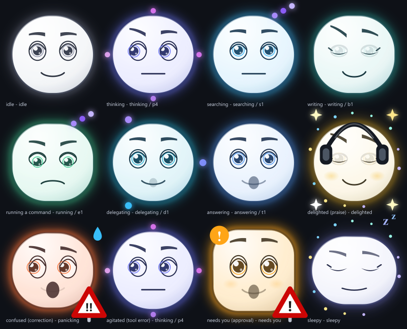

# dsh-companion-face

A draggable, conversation-reactive companion face for the **DeepSeek Harness Web GUI**.

It sits in the corner of the canvas, follows your cursor with its eyes, and wears one of 36
expressions chosen from what the session is *actually doing* — which tool is running, whether
reasoning is streaming, a tool that just failed, an approval waiting on you, a long idle. You can
throw it across the screen and it falls, bounces and settles where it lands.



*Twelve of the 36 expressions, drawn from the rendered component tree. See [Seeing it](#seeing-it).*

---

**Version** 1.9.0 · **Platform** client-only, Web GUI · **Verified against** `@deepseek-ai/dsh` 0.1.1-rc.2
· **Tests** 136 assertions, no dependencies

By Nikos Georgousis · **Hand Water Pump** · [limbo666/DeepSeek_Harness_Companion](https://github.com/limbo666/DeepSeek_Harness_Companion)

## Contents

- [What you get](#what-you-get) · [Options](#options) · [Idle sayings](#idle-sayings)
- [Requirements](#requirements) · [Install](#install) · [Uninstall](#uninstall)
- [Verify](#verify) · [Seeing it](#seeing-it)
- [How it plugs in](#how-it-plugs-in) · [Compatibility and limits](#compatibility-and-limits)
- [Notes](#notes) · [Contributing](#contributing) · [Licence](#licence)

## What you get

- **A face in the canvas** you can drag anywhere. It follows the mouse with its eyes and
  leans toward the cursor.
- **36 expressions** driven by *real* session state — not a mood timer. Which tool is
  running, whether reasoning is streaming, a failing tool, a pending approval, a
  truncated turn, a compaction, a long idle. `ToolResultNode.isError` and
  `pending[].kind` are hard signals; the sentiment readings are keyword heuristics.
- **Drag physics.** Pick it up, throw it, and it falls, bounces and settles exactly where
  you dropped it. Its seat survives a reload.
- **Poke reactions** — click it and it startles, giggles, squishes, spins, melts, blushes;
  fifteen reactions, picked at random.
- **It blinks.** Two offset cycles (3.4–5.9 s, seeded from the mood) drop the lids for 140 ms
  at a time, so the resting face reads as alive rather than as a drawing. The blink is derived
  from the clock rather than scheduled, and never fires while an expression already holds the
  eyes shut. A closed eye is a **filled crescent lid with a lash**, not a bare arc — two thin
  dashes where a face had eyes reads as a corpse — and the blink **snaps** rather than fading,
  because a 140 ms blink against the 400 ms opacity crossfade left the eye and the lid each
  about half-visible at once, a ghosted double image.
- **36 colours, one per mood.** Each mood has its own accent carried by the rim, the glow, the
  cheeks, the irises, the pupils and the contour — plus a slow ±12° hue drift while a state is
  held and a +28° lurch when you poke it. The silhouette is drawn with a thin dark contour
  (1.7 at 7.7:1 contrast) and the accent around it **fades outward**: two blurred strokes that
  get wider, fainter and softer as they travel away from the face, so there is no outer edge at
  all and the face dissolves into whatever it is sitting on instead of wearing a border.
- **Accessories on praise.** Say something kind ("great", "amazing", "very good", "i like
  it", 👍) and it puts something on for 16 seconds: sunglasses, top hat, party hat, cap,
  beanie, crown, headphones, bow tie, monocle, flower crown, scarf, or glasses. Never the
  same piece twice in a row.
- **Long-haul drift objects.** After a state has been held 45 seconds, faint slow shapes
  fade in behind the head — clocks, letters, flowers, clouds, notes, flowing code, candy,
  fruit, hearts — chosen per mood. A reward for patience, not decoration. They sit in the
  three free corners of the frame (the head fills 86×82 of it and the street sign owns the
  bottom-right), each on its own spot, so no object is hidden behind the face or stacked on
  another. See `tools/check-drift.mjs`.
- **A street sign** in the corner, styled as a European warning triangle, showing a symbol
  for notable states only (attention states and the 12 rare ones). Hidden ~87% of the time.
- **Idle sayings.** After 75 seconds of nothing it starts offering opinions — 134 original
  lines of mock-proverb and quiet computing nonsense, one every 75 seconds. See
  [Idle sayings](#idle-sayings) for why they are written rather than scraped.
- **A status chip** in the session header that names the current mood; click it to shrink
  or expand the face.

## Options

Sixteen switches, in **Settings → Plugins → Companion**. Every one defaults to on, so installing
this changes nothing until you turn something off. Changes apply immediately and survive restarts.

| Group | Switches |
|---|---|
| **Interaction** | Move it around · React to a click · Idle gestures · Idle sway · Idle sayings |
| **Responses** | Answer your decisions · Read your mood · Accessories on praise |
| **Appearance** | Blinking · Particle effects · Background objects · Street sign · Fading edge · Mood colours · Speech balloon · Header chip |

Stored in `localStorage` under `dsh.companion-face.options.v1` as a **sparse** map merged over the
defaults, never a full snapshot — so a future version that adds a switch gives it its default
instead of inheriting `undefined` from a settings file written by an older build. There is a
"Turn everything back on" button at the foot of the page.

Two gates are worth knowing about, because they are not simply "stop drawing it":

- **Mood colours off is monochrome**, not half-tinted. Everything derived from the accent — ink,
  sclera, contour, aura, glow, cheeks, irises — collapses to one neutral grey together.
- **Header chip off still feeds the face.** The chip is the only session-scoped seat the plugin
  owns, so it is the bridge that publishes the conversation into the shared store. It returns
  `null` *after* its publishing effects run, not before; hiding it must not blind the face.

## Idle sayings

After 75 seconds with nothing happening, the companion starts offering opinions. One line every
75 seconds, up for 6.5 seconds — so it is audible about 9% of a long wait and silent the rest of
the time. A companion that narrates continuously is not a companion.

The 134 lines are **original**, written for this plugin rather than collected from the internet,
and that is a considered choice rather than laziness:

- A browser bundle that fetched quotations at runtime would need a key-free, CORS-friendly
  service that does not reliably exist, and would fail silently the moment the machine is offline.
- Most of the "wise quotes" circulating online are misattributed. A companion confidently
  crediting the wrong person is worse than one that is honestly making things up.

They are drawn from the idle clock rather than a stored cursor, so the same wait always produces
the same sequence and the whole pool takes about two and three-quarter hours to come round again.
Sayings sit at the **base** of the balloon ladder: a running tool, a live stream, an open approval
or question, an error, a poke or an idle gesture all outrank one, because filler that hides a
signal is a bug. They appear while the face is idle, bored or asleep — a proverb murmured in its
sleep is on purpose — and never while it is yawning, working or waiting on you.

Unlike every other caption, a saying is allowed to wrap. The balloon is otherwise a single clipped
line in `white-space:nowrap`, and a proverb run through that reads *"A watched process never
fini…"*, which is worse than no proverb at all.

## Requirements

- DeepSeek Harness with the **Web GUI** (`dsh web` / `dsh --profile web`).
  Tested against `@deepseek-ai/dsh` **0.1.1-rc.2**. See
  [Compatibility and limits](#compatibility-and-limits) before installing on anything else.
- **Node 18+**, only for the optional self-check. The plugin itself needs no build step.
- No runtime dependencies. No network access at any point.

## Install

There is no package manager involved. `profiles/node_modules` is a plain drop-in
directory, so installation is: **copy a folder, add one row, restart.**

### 1. Copy the package

Copy the whole `dsh-companion-face` folder to `<DSH_HOME>/profiles/node_modules/`.

`DSH_HOME` is `%USERPROFILE%\.dsh` on Windows, or `~/.dsh` elsewhere. If you have set the
`DSH_HOME` environment variable, use that instead.

The result must be:

```
<DSH_HOME>/profiles/node_modules/dsh-companion-face/package.json
<DSH_HOME>/profiles/node_modules/dsh-companion-face/lib/index.js
<DSH_HOME>/profiles/node_modules/dsh-companion-face/lib/client.js
```

### 2. Add one row to the profile patch

Open `<DSH_HOME>/profiles/<profile>/cordis.patch.yml` — for the Web GUI that is usually
`<DSH_HOME>/profiles/web/cordis.patch.yml`.

That file is a **top-level YAML array**. Append this entry to the array:

```yaml
- insert:
    - id: companion-face
      name: 'dsh-companion-face'
```

If the file is empty, or contains only comments, this entry becomes the whole array.
Back the file up first — restoring it is the rollback.

### 3. Restart

Quit and restart the harness. Reload the Web GUI page.

### Or: run the installer

`install.ps1` (Windows) and `install.sh` (Linux/macOS) do steps 1 and 2 automatically.
They are idempotent, they back up `cordis.patch.yml` before touching it, and they refuse to
write a second copy of the row whether the existing `name:` value is quoted or bare.

```powershell
# Windows
pwsh -File install.ps1
pwsh -File install.ps1 -DshHome 'D:\other\.dsh' -Profile web
pwsh -File install.ps1 -DryRun
```

```bash
# Linux / macOS
./install.sh
DSH_HOME=/opt/dsh ./install.sh
DRY_RUN=1 ./install.sh
```

They stop before restarting anything — you restart. Both take a dry-run flag if you would rather
see what they would do first.

**`install.ps1` is the exercised path. `install.sh` has never been executed** — it was written
against the same logic but the development machine has no POSIX shell (no bash, no WSL distro).
It has been reviewed and its patch-row matcher unit-checked against eight YAML shapes, but
*reviewed* is not *run*. Follow the three manual steps above if you would rather not be the first
person to execute it, and please open an issue either way.

## Uninstall

1. Delete `<DSH_HOME>/profiles/node_modules/dsh-companion-face/`.
2. Restore `cordis.patch.yml` from the backup the installer made, or delete the
   `companion-face` entry from the array.
3. Restart.

The only other state is two `localStorage` keys — `dsh.companion-face.seat.v1` (where you left the
face) and `dsh.companion-face.options.v1` (the switches). They are inert once the plugin is gone.

## Verify

Three levels, all offline:

```bash
node verify.mjs              # 136 assertions, no dependencies
node tools/check-fx.mjs      # every effect particle and travel path clears the head
node tools/check-drift.mjs   # every drift object is on its own spot, clear of the face
```

`verify.mjs` fabricates a browser environment, loads `lib/client.js`, renders both
registered components and asserts the contract: mood routing, variant rotation, speech
gating, ambient escalation, poke reactions, the street-sign gate, repetition fatigue,
accessory lifecycle, drift placement, the idle sayings and their precedence, the palette
and line system, the sixteen option switches, drag gravity and the seat.

The suite is **deterministic** — `Math.random` and `Date.now` are both pinned, so two runs produce
byte-identical output. A flaky suite hides real regressions, so that property is treated as part
of the contract.

### Seeing it

None of those checks can judge appearance, so the face can also be **drawn**:

```bash
SHEET_DIR=../dist/renders node verify.mjs                        # this bundle
BUNDLE=../Stable\ 1/companion-face/lib/client.js \
  SHEET_DIR=../dist/renders SHEET_NAME=face-before.png node verify.mjs   # an older one
```

That writes a contact sheet of twelve moods as PNG plus the raw SVG. Rasterizing needs `sharp`;
it is not a dependency of this package, so `tools/sheet.mjs` looks for it in your DSH profile,
then beside the package, and lists every path it tried if it cannot find it. `npm i sharp` in a
clone is enough.

`BUNDLE` points the same harness at a different bundle without modifying it, which is how the
before/after renders in `dist/renders/` were produced. Two caveats: the rasterizer ignores CSS
animations, so particle fields appear at resting opacity and look stronger than live, and it does
not resolve CSS custom properties — which is precisely why a themed face used to render as black
holes there.

A third caveat, because it looks alarming and is not: **the assertions themselves are written
against the current bundle**, so pointing `BUNDLE` at an older one fails most of them. Rendering
`Stable 1` (v20) with this version's harness reports 98 passed and 38 failed — those 38 are the
features v20 does not have (the options page, the fading edge, the idle sayings). That run is for
the picture only; the sheet it writes is correct. Use the frozen `Stable 1/companion-face/verify.mjs`
when you want v20 *tested* rather than v20 *drawn*.

The two `tools/` checkers exist because a feature can pass every functional check and still
be invisible. `check-fx` caught spark and codeflow particles grazing the silhouette;
`check-drift` caught two drift spots sitting *under* the face and a stride that stacked
three objects on two positions. Neither class of bug is visible to a check that only counts
what was rendered.

It **cannot** tell you whether any of it looks good. Gesture, timing, colour and taste are
not measurable.

## How it plugs in

The package is a **client-only** plugin. `package.json` declares:

```json
"dsh": { "client": { "platform": "web" } }
```

The host half of the client module system reads that declaration, resolves the bundle via
`exports["./client"]`, and serves it into `window.__DSH_BOOT__`. The bundle self-registers
into the module table and registers **three** Slot occupants:

| Slot | Scope | What it renders |
|---|---|---|
| `shell.overlay` | root | the face — the frame-wide floating layer, above all columns |
| `conversation.session.header.utilities` | session | the mood chip in the session header |
| `settings.plugins.tab` | root | the options page, as a "Companion" tab in Settings → Plugins |

`shell.overlay` is **root** scoped and therefore carries no session props, so the face
alone cannot see the conversation. The header chip is **session** scoped and reads the
conversation through `useSession`; it publishes what it reads into a shared store, and the
face subscribes to that store. That bridge is why there are two registrations for the visual
half and not one.

Service readiness is declared at the Cordis level inside the bundle:

```js
exports.inject = ['slots', 'timer']
```

You do **not** need a `dsh.client.inject` list. That field is for packages that consume
*other client modules* — code arrival needs no sequencing, because a factory that requires
a registered-but-unmaterialised module materialises it recursively.

The host half (`lib/index.js`, 663 bytes) is a deliberate **no-op**. This plugin contributes no
host services, no model tools and no commands; everything it does happens in the page.

## Compatibility and limits

Written down because a README that only lists features is not telling you how much to trust it.

- **The harness is a release candidate.** `@deepseek-ai/dsh` 0.1.1-rc.2 is what this was built and
  tested against. A pre-1.0 shell may move under a plugin like this one without warning.
- **It depends on shell internals that are not a published API:** the three slot ids above,
  `window.__ModuleLoader__`, the `settings.plugins.tab` registration contract, the shape of
  `pending[].kind` and `pending[].payload.toolName`, `ToolResultNode.isError`, and seven
  `--dsw-alias-*` theme tokens. If a shell upgrade changes any of them, this plugin breaks — most
  likely by silently rendering nothing, which is the hardest failure to notice.
- **Approval reactions are an inference, not a signal.** "Granted" is inferred from *nothing
  having refused it and the tool having run*; the runtime records rejections as a reason string
  and grants as an absence. If upstream wording changes, a granted approval reads as no reaction
  rather than a wrong one — deliberately the safe direction, but it means the feature can go
  quietly dead.
- **Everything it knows about your conversation is read in the browser and never leaves it.**
  Sentiment is a keyword heuristic with a negation guard, not a model. There is no network
  access anywhere in the bundle.
- **No CI.** The suite is strong and deterministic, but nothing runs it on push yet.
- **No automated visual test.** Nobody has looked at this in a real browser except me, and I have
  no image input — the renders exist so *you* can judge them. Layout, type and colour are your
  call.
- **The git history starts at the first release.** Everything before 1.9.0 was developed outside
  version control, so there is no earlier history to inspect for how it got this way. `CHANGELOG.md`
  is the substitute, and it records the bugs and the wrong turns rather than only the features.

## Notes

- **It answers your decisions, not just your words.** Grant an approval and it thanks you;
  refuse one and it accepts that calmly rather than treating it as a fault; cancel and it is
  surprised; answer a question and it is pleased. An approval outcome is not a node of its own
  — the tool runtime records a refusal as a DENY reason string — so the outcome is read from
  what the decision leaves behind. See `CHANGELOG.md` for the exact mapping.
- **The face is not a status readout and no longer tries to be.** Tool errors flash an
  agitated face for 8 seconds and settle, rather than holding an angry expression until
  the error scrolls out of the window.
- **Sentiment detection is a keyword heuristic with a negation guard.** `"this is not very
  good"` no longer reads as praise: a praise word is rejected when one of `not / n't / no /
  never / hardly / barely` appears in the 14 characters before it. The window is deliberately
  blunt, so the genuine `"I can't thank you enough"` is also rejected. Reading an insult as
  praise is judged the worse error, so the guard errs that way.
- **Accessibility.** The face is `role="img"` with an `aria-label` naming its mood; the
  speech balloon is a real button (focusable, Enter/Space); the chip is a real button. All
  animation is disabled under `prefers-reduced-motion: reduce`.
- **Theme, and why the face does not follow it.** The face is an *illustration*, not chrome:
  skin, ink and contour are fixed materials and colour comes from one accent per mood. It must
  not read `--dsw-alias-*` tokens, because those swap between the light and dark shell while
  the skin does not — `--dsw-alias-label-primary` is `neutral-bluish-1000` in the light theme
  and `neutral-bluish-50` in the dark one, so a themed ink drew near-white features on a
  near-white head in dark mode. The speech bubble, the header chip and the sign post *do* read
  tokens, because they sit on the shell. `verify.mjs` walks the rendered tree and fails if any
  paint inside the face contains `var(--dsw-alias`.
- **The palette is derived, not hand-picked.** 36 accents, grouped by emotional family, with
  the warm band (hue 18–115°) held under L 0.545 because golds and yellows wash out on an
  off-white face and the cool half does not. Guaranteed 36 distinct, ≥1.62:1 against the skin
  and ≥4.37:1 against a near-black page. See `DESIGN.md` for the full review.

## Contributing

The invariants this file must keep are listed as a numbered contract at the top of
`lib/client.js`, each with the check that covers it in `verify.mjs`. Read that list first — most
of it is the residue of a real bug, and several of the entries exist because the obvious
implementation was wrong in a way that took a while to see.

If you change behaviour, add the assertion. `node verify.mjs` is fast, dependency-free and
deterministic; there is no reason to skip it. If you change anything visual, render a sheet
before and after and say which two you compared.

## Licence

MIT — © 2026 Nikos Georgousis (Hand Water Pump). See `LICENSE`.